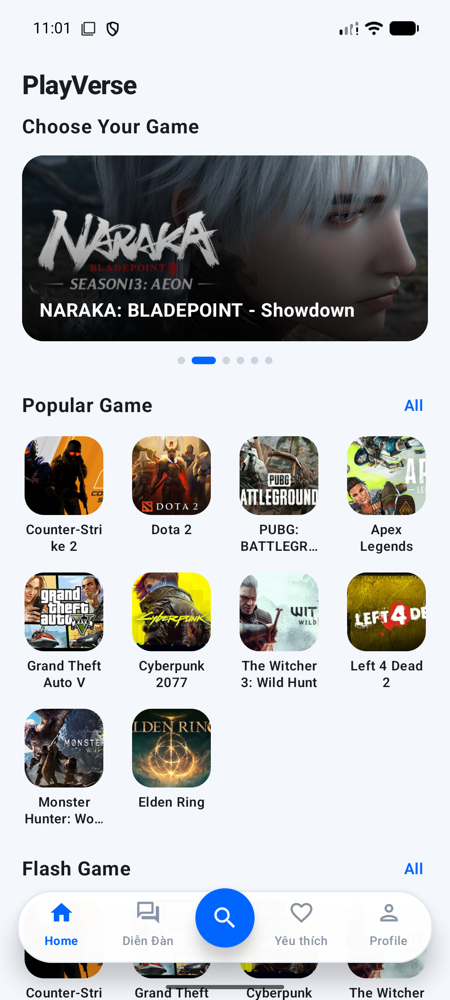
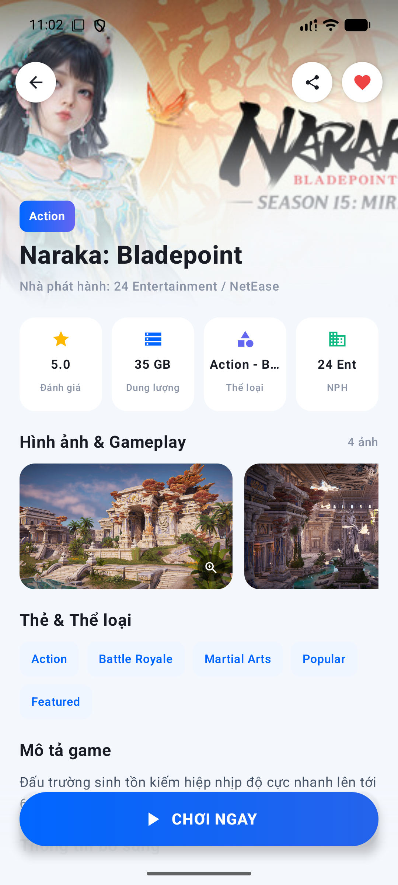
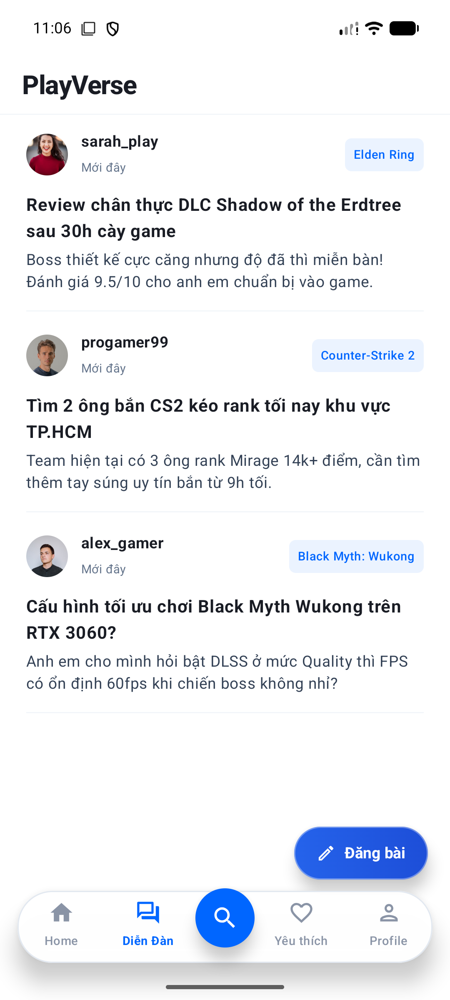
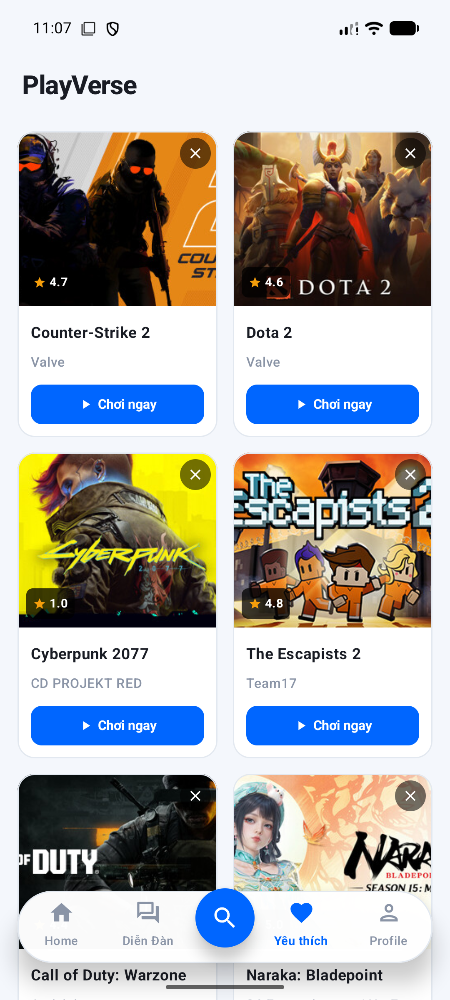
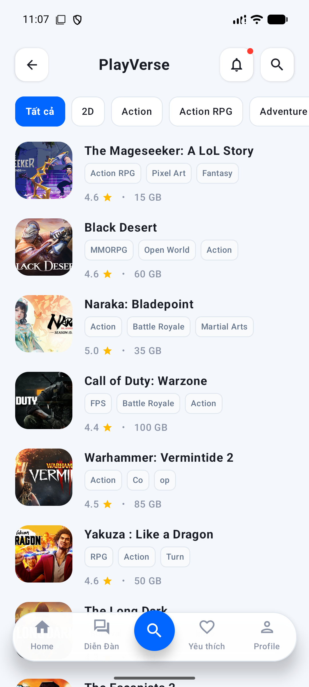
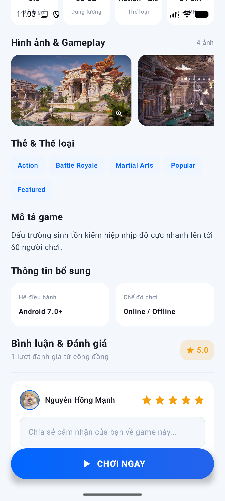
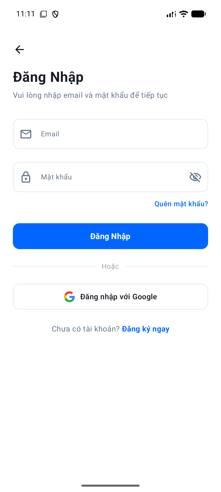
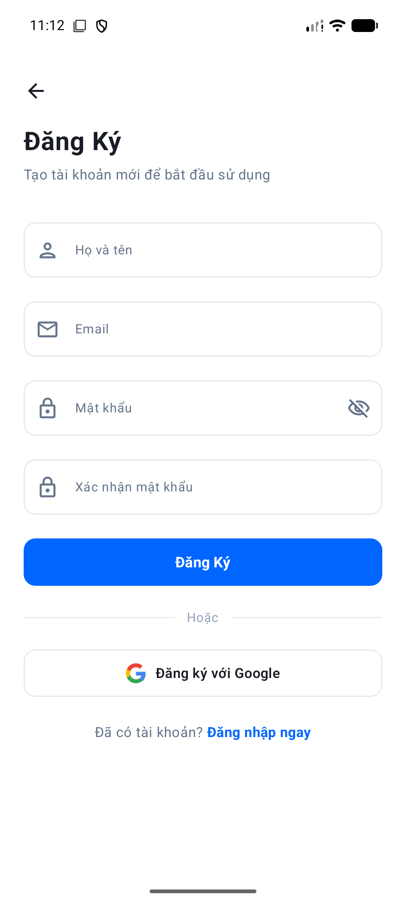

# 🎮 PlayVerse - Android Game Discovery & Community

Ứng dụng di động Android giúp game thủ khám phá các tựa game nổi bật, xem thông tin chi tiết, đánh giá - bình luận, lưu game yêu thích và tham gia diễn đàn cộng đồng.

---

## 📱 Bản Cài Đặt (Release APK)

File APK đã được biên dịch hoàn tất ở chế độ **Release**, đã ký sẵn và có thể tải về cài đặt trực tiếp trên thiết bị Android:

* **File cài đặt:** [`release/PlayVerse-v1.0-release.apk`](release/PlayVerse-v1.0-release.apk)
* **Dung lượng:** ~14.2 MB
* **Hỗ trợ:** Android 7.0 (API 24) trở lên

---

## 📸 Demo Giao Diện

| Trang chủ | Chi tiết Game | Diễn đàn | Yêu thích |
| :---: | :---: | :---: | :---: |
|  |  |  |  |

<b>🔍 Xem thêm các màn hình khác (Tìm kiếm, Đánh giá, Đăng nhập...)</b>

 

| Khám phá & Lọc | Đánh giá & Bình luận | Đăng nhập | Đăng ký |
| :---: | :---: | :---: | :---: |
|  |  |  |  |

---

## 🎯 Các Chức Năng Chính (Core Features)

1. **Trang chủ (Home):**
   * Carousel banner các sự kiện game hot dạng slider.
   * Danh sách game thịnh hành (*Popular Games*) và giải trí nhanh (*Flash Games*).

2. **Khám phá & Tìm kiếm (All Games):**
   * Tìm kiếm game tức thì theo tên trong thời gian thực.
   * Lọc nhanh danh sách theo các thể loại (*Action, RPG, Battle Royale, 2D...*).

3. **Chi tiết tựa game (Game Detail):**
   * Banner hero, thông số cấu hình, dung lượng và nhà phát hành.
   * Thư viện hình ảnh gameplay chất lượng cao.

4. **Đánh giá & Bình luận:**
   * Hệ thống chấm điểm sao (1.0 - 5.0 ⭐).
   * Gửi bình luận, nhận xét và chia sẻ trải nghiệm chơi game.

5. **Danh sách yêu thích (Wishlist):**
   * Lưu và quản lý các tựa game yêu thích chỉ với một chạm.
   * Tự động đồng bộ theo từng tài khoản người dùng.

6. **Diễn đàn cộng đồng (Community):**
   * Bảng tin thảo luận, chia sẻ kinh nghiệm, rủ đồng đội kéo rank.
   * Đăng bài viết mới dễ dàng.

7. **Tài khoản cá nhân & Bảo mật (Profile):**
   * Đăng nhập / Đăng ký bằng Email & Mật khẩu hoặc **Google Sign-In**.
   * Đổi ảnh đại diện trực tiếp từ thư viện ảnh của thiết bị.

---

## 🛠️ Công Nghệ & Kiến Trúc (Tech Stack & Architecture)

* **Kiến trúc:** Clean Architecture + MVVM (Model - View - ViewModel)
* **Ngôn ngữ:** Kotlin
* **Giao diện:** Jetpack Compose + Material 3
* **Quản lý trạng thái:** StateFlow, SharedFlow, Kotlin Coroutines
* **Điều hướng:** Jetpack Navigation Compose
* **Kết nối mạng & API:** Retrofit 2 + Gson Converter
* **Tải ảnh:** Coil Compose
* **Xác thực:** Google Play Services Auth + Local Session Storage (UserPreferences)

---

## 👤 Tác Giả & Thông Tin

* **Tác giả:** Nguyễn Hồng Mạnh
* **Email:** hongmanhunity@gmail.com
* **Phiên bản:** v1.0.0

